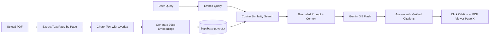

# Pustak AI

An AI-powered research assistant inspired by NotebookLM. It allows you to upload PDF documents (research papers, reports, notes), ask questions, and receive grounded answers backed by clickable citations that navigate directly to the exact source page in a built-in PDF viewer.

---

## Key Features

- **Document-Grounded Q&A**: Answers are synthesized strictly from the content of your uploaded PDFs.
- **Clickable Citations**: Inline citation pills link directly to the exact page supporting the claim. Clicking one opens the built-in PDF viewer at that page.
- **Research Studio**: Generate concise summaries, detailed breakdowns, key takeaways, and suggested questions from your documents.
- **Three-Panel Workspace**: Organized layout featuring Sources, Chat, and Studio panels with collapsible sidebars.
- **Dark & Light Mode**: Dual theme with an interactive navbar toggle and persistent preferences.
- **Multi-Document Support**: Filter queries across specific documents or all documents within a notebook.

---

## Tech Stack

- **Frontend**: React (Vite), Tailwind CSS, Lucide Icons, PDF.js (`pdfjs-dist`)
- **Backend**: Node.js, Express.js
- **Database & Storage**: Supabase (PostgreSQL with `pgvector` for similarity search, Storage bucket for PDFs)
- **AI Models**: Google Gemini (`gemini-3.5-flash` for synthesis, `gemini-embedding-001` with 768d output for vector search)

---

## How It Works



1. **Ingestion**: When you upload a PDF, it is stored in Supabase Storage, parsed page-by-page, chunked into overlapping passages, and embedded into 768-dimensional vectors.
2. **Retrieval (RAG)**: Asking a question embeds the query and matches against document chunks using cosine similarity in `pgvector`.
3. **Synthesis & Citation**: Gemini generates an answer citing specific sources (`[cite:X]`). The backend validates each citation against the retrieved chunks to prevent hallucinations.
4. **Viewer Navigation**: Clicking any citation badge opens the PDF directly on that cited page in the canvas viewer.

---

## Local Setup

### Prerequisites

- Node.js (v20+)
- A [Supabase](https://supabase.com) account
- A [Google Gemini API Key](https://aistudio.google.com/app/apikey)

### 1. Clone the Repository

```bash
git clone https://github.com/tanmaysrivastava45/Pustak-AI.git
cd Pustak-AI
```

### 2. Configure Supabase

In your Supabase project dashboard, open the **SQL Editor** and run the migration files in `supabase/migrations/` in order:
1. `20260224000001_initial_schema.sql` (enables `pgvector` and creates tables)
2. `20260224000002_rls_policies.sql` (enables Row Level Security)
3. `20260224000003_vector_search_function.sql` (creates similarity search function)

Then go to **Storage** and create a private bucket named `documents`.

### 3. Environment Variables

**Server (`server/.env`):**
```env
PORT=5000
NODE_ENV=development
CLIENT_ORIGIN=http://localhost:5173

SUPABASE_URL=https://your-project.supabase.co
SUPABASE_ANON_KEY=your-supabase-anon-key
SUPABASE_SERVICE_ROLE_KEY=your-supabase-service-role-key
PDF_STORAGE_BUCKET=documents

GEMINI_API_KEY=your-gemini-api-key
GEMINI_EMBEDDING_MODEL=gemini-embedding-001
GEMINI_CHAT_MODEL=gemini-3.5-flash
```

**Client (`client/.env`):**
```env
VITE_SUPABASE_URL=https://your-project.supabase.co
VITE_SUPABASE_ANON_KEY=your-supabase-anon-key
VITE_API_URL=http://localhost:5000/api/v1
```

### 4. Install and Run

From the root directory:

```bash
# Install dependencies
npm install
cd server && npm install
cd ../client && npm install
cd ..

# Start development servers
npm run dev
```

- Frontend: `http://localhost:5173`
- Backend API: `http://localhost:5000`

---

## Deployment

### Backend (Render)
1. Create a new **Web Service** on Render connected to this repository.
2. Set **Root Directory** to `server`.
3. Set **Build Command** to `npm install` and **Start Command** to `npm start`.
4. Add the environment variables from `server/.env.example`.

### Frontend (Vercel)
1. Import this repository into Vercel.
2. Set **Root Directory** to `client`.
3. Add the environment variables (`VITE_SUPABASE_URL`, `VITE_SUPABASE_ANON_KEY`, and `VITE_API_URL` pointing to your Render backend).
4. Deploy.

---

## License

MIT
