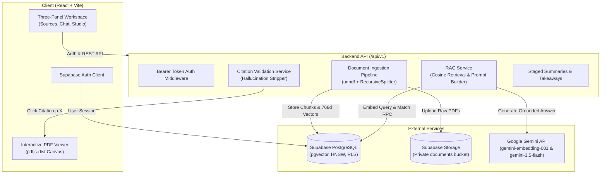

# Pustak AI — Full-Stack AI Research Assistant

> **"Upload your knowledge. Ask questions. Get answers backed by your sources."**

Pustak AI is a complete, functional, **NotebookLM-inspired AI research assistant**. It enables users to upload PDF documents, ask complex natural-language questions, receive answers strictly grounded in the uploaded material, and click verifiable citations that navigate directly to the exact source page in the built-in PDF viewer.

---

## 1. Architecture Overview



---

## 2. Technology Decisions

| Domain | Technology | Justification |
|---|---|---|
| **Language** | JavaScript (ESM throughout) | Modular ES Modules with `.js` and JSX for React components. |
| **Frontend** | React 18, Vite, Tailwind CSS, Lucide React | High-performance reactive interface with dual night/light theme support. |
| **State & Routing** | React Router v6, TanStack Query v5 | Client-side routing and server-state caching. |
| **Backend** | Node.js v20+, Express.js | Event-driven REST API with clean modular service architecture. |
| **Validation** | Zod | Runtime type safety and schema validation for API inputs. |
| **AI SDK** | `@google/genai` (official Google unified SDK) | Integration with `gemini-embedding-001` and `gemini-3.5-flash`. |
| **Text Splitting** | `@langchain/textsplitters` | `RecursiveCharacterTextSplitter` preserving semantic boundaries with overlap. |
| **PDF Extraction**| `unpdf` (Mozilla PDF.js wrapper) | Page-by-page text extraction preserving exact page numbers. |
| **Client PDF Viewer**| `pdfjs-dist` | In-browser canvas rendering with page navigation and zoom controls. |
| **Database & Vector**| Supabase PostgreSQL with `pgvector` | HNSW indexed vector similarity search via `1 - (embedding <=> query)`. |
| **Authentication** | Supabase Auth | Secure JWT session management with database Row Level Security (RLS). |
| **File Storage** | Supabase Storage | Private bucket with timed signed URLs. |

---

## 3. RAG Pipeline Deep Dive

### A. Document Ingestion Pipeline
1. **Magic Bytes Validation**: Verifies that the file buffer begins with `%PDF-` (hex `25 50 44 46 2d`) and is under 25MB.
2. **Storage Upload**: Stores the PDF in the private Supabase Storage bucket (`documents/${userId}/${timestamp}-${file}`).
3. **Page-by-Page Extraction**: `unpdf` extracts text individually for each page, preserving 1-based `pageNumber`.
4. **Hierarchical Chunking**: `RecursiveCharacterTextSplitter` chunks text with ~800 character window and ~120 overlap, splitting on paragraphs (`\n\n`), newlines (`\n`), and sentences (`. `).
5. **Embedding Generation**: Gemini `gemini-embedding-001` generates dense 768-dimensional float vectors in controlled batches.
6. **Vector Storage**: Chunks and embeddings are stored in the `document_chunks` table with `user_id` attribution.
7. **State Machine**: Transitions from `uploaded` → `processing` → `ready` (or `failed` with error message).

### B. Retrieval & Grounded Q&A
1. **Query Embedding**: The user's question is converted into a 768d vector using `gemini-embedding-001`.
2. **PostgreSQL RPC Cosine Search**: `match_document_chunks` performs similarity calculation:
   $$\text{Cosine Similarity} = 1 - (\mathbf{u} \Leftrightarrow \mathbf{v})$$
   Filtered strictly by `filter_user_id = auth.uid()` to prevent cross-user access, and optionally by `filter_document_ids`.
3. **Grounded Prompt Construction**:
   Retrieved chunks are structured as `[Source 1] (Document, Page X): Content`. The prompt explicitly instructs Gemini to answer **only** from the sources and report insufficient evidence if sources lack the answer.
4. **Citation Validation**:
   Citation markers in the answer (e.g. `[cite:1]`) are verified against the retrieved chunks. **Hallucinated citation numbers are stripped automatically**.
5. **Persistence**: Questions, answers, and structured citation arrays are saved in PostgreSQL.

---

## 4. Database Schema & Migrations

Migrations are located in `supabase/migrations/`:

- `20260224000001_initial_schema.sql`: Enables `vector`, creates `profiles`, `notebooks`, `documents`, `document_chunks` (vector 768 with HNSW index), `conversations`, `messages`, and `document_summaries`.
- `20260224000002_rls_policies.sql`: Enables Row Level Security on all tables, isolating data by `auth.uid() = user_id`.
- `20260224000003_vector_search_function.sql`: Defines `match_document_chunks` RPC function.

### Running Migrations in Supabase
1. In your Supabase project dashboard, navigate to **SQL Editor**.
2. Run the SQL files in numerical order:
   - Run `20260224000001_initial_schema.sql`
   - Run `20260224000002_rls_policies.sql`
   - Run `20260224000003_vector_search_function.sql`
3. In **Storage**, create a private bucket named `documents`.

---

## 5. Local Setup & Installation

### Prerequisites
- Node.js v20.x or higher
- Supabase account ([supabase.com](https://supabase.com))
- Google Gemini API key ([aistudio.google.com](https://aistudio.google.com/app/apikey))

### 1. Clone & Install
```bash
git clone https://github.com/tanmaysrivastava45/Pustak-AI.git
cd Pustak-AI

# Install root orchestration tools
npm install

# Install server dependencies
cd server && npm install

# Install client dependencies
cd ../client && npm install
```

### 2. Configure Environment Variables

**Server Configuration (`server/.env`):**
```env
PORT=5000
NODE_ENV=development
CLIENT_ORIGIN=http://localhost:5173

# Supabase
SUPABASE_URL=https://your-project.supabase.co
SUPABASE_ANON_KEY=your-supabase-anon-key
SUPABASE_SERVICE_ROLE_KEY=your-supabase-service-role-key
PDF_STORAGE_BUCKET=documents

# Google Gemini API
GEMINI_API_KEY=your-gemini-api-key
GEMINI_EMBEDDING_MODEL=gemini-embedding-001
GEMINI_CHAT_MODEL=gemini-3.5-flash

# RAG Configuration
RAG_CHUNK_SIZE=800
RAG_CHUNK_OVERLAP=120
RAG_RETRIEVAL_LIMIT=6
RAG_SIMILARITY_THRESHOLD=0.35
```

**Client Configuration (`client/.env`):**
```env
VITE_SUPABASE_URL=https://your-project.supabase.co
VITE_SUPABASE_ANON_KEY=your-supabase-anon-key
VITE_API_URL=http://localhost:5000/api/v1
```

*(Note: If you run the frontend without Supabase credentials, Pustak AI runs in interactive Demo Mode automatically).*

### 3. Start Development Servers
From the root directory:
```bash
npm run dev
```
- Client runs on `http://localhost:5173`
- Server runs on `http://localhost:5000`
- API Health check: `http://localhost:5000/api/v1/health`

---

## 6. Testing

The backend includes a comprehensive unit and integration test suite covering chunking, citation validation, retrieval filtering, and the simulated end-to-end RAG workflow.

Run all tests:
```bash
npm test
```
Or inside `server/`:
```bash
cd server
npm test
```

Expected output:
```text
 ✓ tests/citation.test.js (4 tests)
 ✓ tests/retrieval.test.js (2 tests)
 ✓ tests/chunking.test.js (4 tests)
 ✓ tests/workflow.integration.test.js (3 tests)
 ✓ tests/auth.test.js (3 tests)

 Test Files  5 passed (5)
      Tests  16 passed (16)
```

---

## 7. Deployment Guide

### Frontend Deployment (Vercel)
1. Push your repository to GitHub.
2. In Vercel, import the repository and set the **Root Directory** to `client`.
3. Build Settings:
   - Build Command: `npm run build`
   - Output Directory: `dist`
4. Set Environment Variables:
   - `VITE_SUPABASE_URL`: Your Supabase Project URL
   - `VITE_SUPABASE_ANON_KEY`: Your Supabase Anon Key
   - `VITE_API_URL`: Your deployed backend URL + `/api/v1` (e.g. `https://pustak-api.onrender.com/api/v1`)
5. Deploy.

### Backend Deployment (Render)
1. In Render, create a new **Web Service** connected to your repository.
2. Set **Root Directory** to `server`.
3. Configuration:
   - Runtime: `Node`
   - Build Command: `npm install`
   - Start Command: `node src/server.js`
4. Environment Variables:
   - `PORT`: `5000`
   - `NODE_ENV`: `production`
   - `CLIENT_ORIGIN`: Your deployed Vercel frontend URL
   - `SUPABASE_URL`: Your Supabase Project URL
   - `SUPABASE_SERVICE_ROLE_KEY`: Your Supabase Service Role Key
   - `SUPABASE_ANON_KEY`: Your Supabase Anon Key
   - `GEMINI_API_KEY`: Your Gemini API key
   - `PDF_STORAGE_BUCKET`: `documents`
5. Deploy.

---

## 8. Verification & Acceptance Criteria Checklist

- [x] **User Authentication**: Sign-up, Sign-in, Sign-out, and password reset with Supabase Auth and session persistence.
- [x] **Notebook Management**: Create, rename, delete, and list notebooks with real-time source counts.
- [x] **PDF Ingestion**: Secure upload with MIME and magic byte checks, page-by-page text extraction, overlapping chunking, and batch embedding.
- [x] **Processing State Machine**: Real-time status badges (`uploaded` → `processing` → `ready` / `failed`) with automatic frontend polling.
- [x] **pgvector Semantic Search**: HNSW cosine distance search with strict user and document ID isolation.
- [x] **Grounded Gemini Q&A**: Strict evidence-based answers with honest insufficient-evidence handling.
- [x] **Verifiable Citations**: Backend validation against retrieved chunks; hallucinated markers stripped; interactive citation pills.
- [x] **Built-in PDF Viewer**: Canvas-based PDF viewer that jumps directly to the cited page when clicked.
- [x] **Research Studio**: Generates concise summaries, detailed breakdowns, key takeaways, and suggested questions with map-reduce batching.
- [x] **Test Suite Passing**: Unit and integration tests for chunking, citations, retrieval, and auth passing 100%.

---

## 9. License
MIT License.
